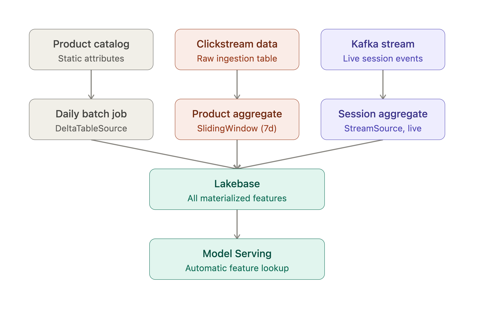
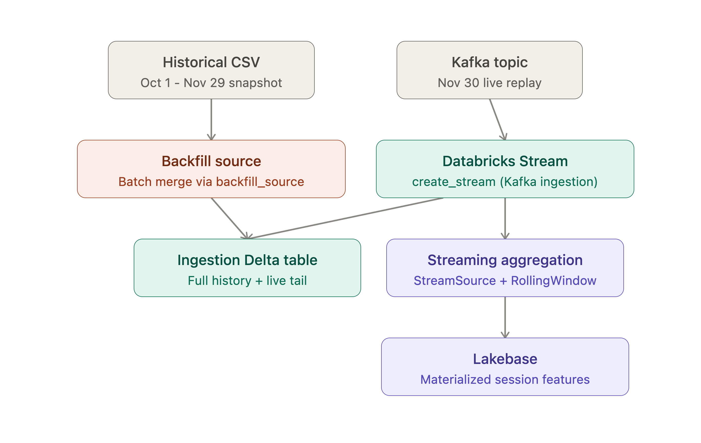
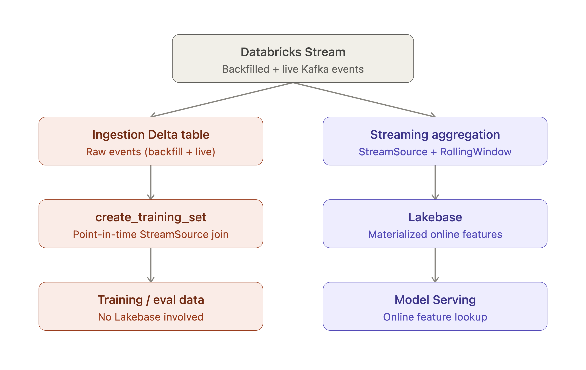
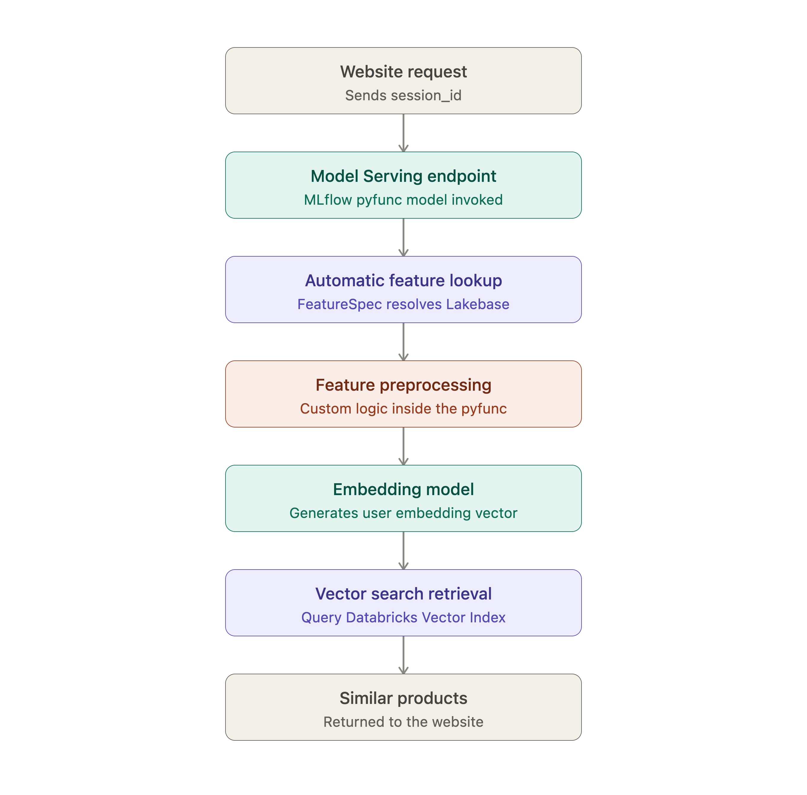

### From Batch to Milliseconds: Real-Time Feature Views for Recommenders

A prototype recommendation system built on the [eCommerce Behavior Data clickstream dataset](https://www.kaggle.com/datasets/mkechinov/ecommerce-behavior-data-from-multi-category-store), demonstrating Databricks' new streaming Feature Views capability. The system combines near real-time, within-session user behavior with slower-moving product-level features to power session-aware product recommendations — computing the same feature definitions consistently for both model training and online serving.

**To implement the project**, clone this repository into your Databricks Workspace, rename `config_template.yml` to `config.yml` and fill in the parameters according to the file's instructions. Then, run the numbered notebooks in sequence. The file, `AGENT.md` will help Genie Code understand the project and adapt it to your specific use case.

Databricks' streaming Feature Views functionality is used to backfill offline feature tables with historical data while new events data streams directly to Lakebase for near-real time availability.

Offline tables support data analysis and model training feature creation. Feature Views point-in-time join functionality allows training and evaluation sets to be created over any time periods. Features are created "on the fly", preventing data leakage between training and evaluation datasets. 

Every click updates the user's session state, and the model's recommendations shift accordingly — in milliseconds.

